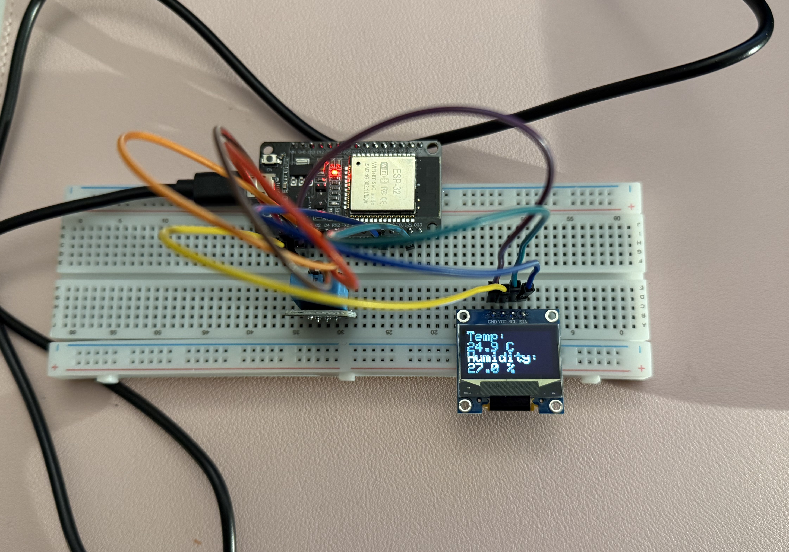

# ESP32 Temperature Monitor with Qt (Work in Progress)

## Overview

This project is an environmental monitoring system built using an ESP32 microcontroller, a DHT11 temperature and humidity sensor, and a Qt desktop application.

The system reads temperature and humidity values from the DHT11 sensor, sends the measurements through serial communication, and displays the information in a desktop GUI. The project is being developed in phases to demonstrate the complete workflow from hardware integration to desktop software development.

## Features

- Real-time temperature monitoring
- Real-time humidity monitoring
- ESP32 and DHT11 integration
- Serial communication between device and computer
- Qt desktop graphical user interface - TBD
- Modular and expandable architecture


## Project Development Phases

### Phase 1: Hardware Integration

The DHT11 sensor was connected to the ESP32 development board using GPIO4. This phase focused on verifying wiring and establishing communication between the sensor and microcontroller.

#### Wiring

| DHT11 Pin | ESP32 Pin |
|-----------|-----------|
| VCC | 3.3V |
| GND | GND |
| DATA | GPIO4 |

| OLED Pin | ESP32 Pin |
|----------|-----------|
| VCC | 3.3V |
| GND | GND |
| SDA | GPIO21 (D21) |
| SCL | GPIO22 (D22) |

#### Hardware Setup


---

### Phase 2: Sensor Data Acquisition

After the hardware was connected, the ESP32 was programmed to read temperature and humidity data from the DHT11 sensor.

Sample output:

```text
Temperature: 24.9°C
Humidity: 27.0%
```

#### Serial Monitor Output

TBD.....

---

### Phase 3: Data Communication

The ESP32 transmits sensor measurements through a USB serial connection.

Data format:

```text
24.3,46.0
24.2,45.0
24.4,47.0
```

Where:

- First value = Temperature (°C)
- Second value = Humidity (%)

---

### Phase 4: Qt Desktop Application - TO BE DONE

A desktop application was developed using Qt to receive and display sensor readings in real time.

The application:

- Connects to the ESP32 serial port
- Receives sensor measurements
- Updates displayed values automatically
- Provides a simple user-friendly interface

#### Qt Interface

TBD...


## System Architecture

```text
DHT11 Sensor
      │
      ▼
    ESP32
      │
 USB Serial
      │
      ▼
 Qt Desktop Application
      │
      ▼
 Real-Time Display
```

---

## Hardware Requirements

- ESP32 Development Board
- DHT11 Temperature and Humidity Sensor
- Breadboard
- Jumper Wires
- USB Cable

## Software Requirements

### ESP32

- Arduino IDE 2.x
- ESP32 Board Package
- DHT Sensor Library
- Adafruit Unified Sensor Library

### Desktop Application

- Qt 6
- Qt Creator
- Qt Serial Port Module

---

## Getting Started
 TBD...

## Future Improvements

- CSV data logging
- Historical data visualization
- Temperature and humidity graphs
- Wi-Fi communication
- Cloud-based monitoring
- Sensor calibration support


## Made by 
Isabella Salim

## Note
**This project is intended for educational and learning purposes.**